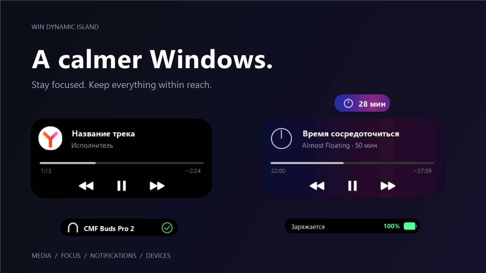
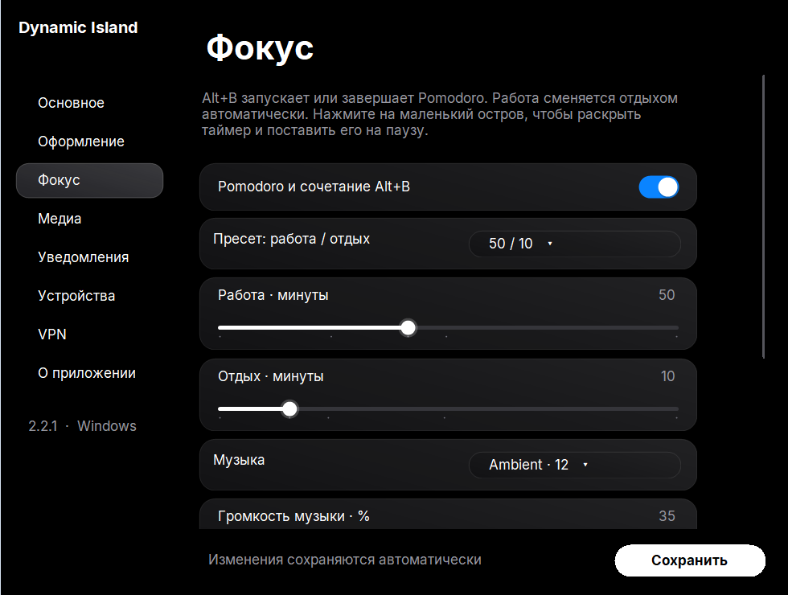
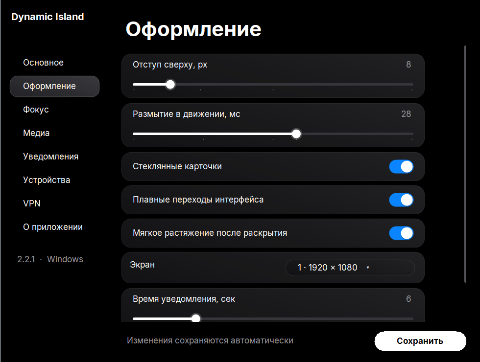

<div align="center">



# Win Dynamic Island

**Меньше отвлечений. Больше пространства для важного.**

Музыка, уведомления, Pomodoro и состояние устройств — в одном живом острове для Windows.

[](#установка)
[](https://github.com/JazzyBeen/WinDynamicIsland/actions/workflows/build.yml)
[](https://github.com/JazzyBeen/WinDynamicIsland/releases)
[](#english)

[**Скачать**](https://github.com/JazzyBeen/WinDynamicIsland/releases/latest) · [Возможности](#возможности) · [Сборка](#сборка) · [English](#english)

</div>

## Возможности

| | Что умеет остров |
|---|---|
| **Фокус** | Alt+B запускает Pomodoro: 50/10, 25/5, 90/20 или свои интервалы. Пауза, музыка, автоматическая смена работы и отдыха. В компактном режиме — медленный сине-розово-фиолетовый градиент. |
| **Медиа** | Управление системными медиасессиями: пауза, перемотка и таймлайн. Разворачивается по нажатию, сворачивается при нажатии вне острова. |
| **Уведомления** | Выбранные приложения или все отправители Windows. Аватарки, очередь сообщений и замена стандартных баннеров. |
| **Устройства** | Bluetooth-наушники, зарядка и низкий заряд батареи. |
| **Быстрые индикаторы** | Громкость, микрофон, F7, дополнительные индикаторы Caps Lock и раскладки. |
| **VPN** | Windows VPN, Sota, команды CLI и наблюдение за сетевым адаптером. Переключение Alt+N для настроенного провайдера. |
| **Оформление** | Чёрный фон, плавное появление и сворачивание, размытие в движении, мягкое растяжение. Настройки анимаций и выбор монитора. |

### Настроить под себя



<details>
<summary><b>Оформление и поведение</b></summary>
<br>

</details>

Настройки сохраняются автоматически, в том числе при закрытии окна и полном завершении приложения. Крестик скрывает настройки в трей; завершение — через меню значка в трее. Автозагрузка переключается в разделе «Основное».

## Установка

1. Скачайте ZIP из [Releases](https://github.com/JazzyBeen/WinDynamicIsland/releases/latest) и распакуйте его.
2. Запустите `Install.cmd`. Приложение устанавливается для текущего пользователя.
3. Откройте настройки из меню «Пуск» или значка в трее.

**Требования:** Windows 10/11 x64, .NET Framework 4.8. Возможности медиа и уведомлений зависят от API Windows и поддержки в приложении-источнике. Windows может предупредить о неподписанной сборке.

### Музыка и Pomodoro

Набор содержит **12 Ambient + 12 Lo-fi** треков. Выберите архив `with-music` — он уже содержит треки. При установке папка `app/Music` будет скопирована автоматически.

Из исходников набор скачивается так:

```powershell
powershell -ExecutionPolicy Bypass -File .\scripts\Download-Music.ps1
```

Скрипт скачивает исходный архив Open Lo-Fi (~529 MiB), проверяет SHA-256 выбранных файлов и устанавливает только 24 трека (~79 MiB). После этого музыка работает офлайн. Треки перемешиваются без повторов до конца набора; очередь сохраняется между сессиями и перезапусками приложения. Можно добавить свои MP3 в `%LOCALAPPDATA%\WinDynamicIsland\Music\Ambient` и `Lofi`. Во время перерыва музыка по умолчанию приостанавливается. Изменения длительности применяются к следующей запущенной сессии; громкость — к текущей.

### Браузеры и Spotify

**Системные медиасессии работают без расширения.** Это основной способ интеграции Spotify, плееров и поддерживаемых браузерных сайтов.

Для сайтов без системной медиасессии есть дополнительное расширение. В настройках «Медиа» нажмите кнопку подготовки расширения и загрузите открывшуюся папку через `browser://extensions` → режим разработчика → «Загрузить распакованное». В Chrome/Edge используйте соответствующую страницу расширений. После первого подключения обновите уже открытые вкладки.

Канал восстанавливается после запуска браузера и пробуждения фонового обработчика. Некоторые браузеры отключают расширения из непроверенных источников: приложение не обходит эту защиту. Для массовой установки расширение потребуется опубликовать в магазине. Работа с абсолютно любым сайтом, DRM-плеером или приложением не гарантируется.

### VPN

Провайдер и команды задаются в настройках острова. Для Sota запись профиля встроена в эту же страницу: отдельное окно настройки больше не нужно. Windows запросит повышение прав для фонового помощника. Переподключение при записи выполняется пользователем вручную; приложение не отключает VPN самостоятельно во время настройки.

VPN с CLI/API можно подключить через команды. Наблюдение за адаптером показывает состояние интерфейса; оно не доказывает доступность VPN-сервера. Универсальной команды подключения для всех VPN не существует. Пароли не следует передавать через аргументы команд — используйте хранилище учётных данных своего VPN-клиента.

## Приватность

- Аккаунт и облачный сервер для работы острова не нужны.
- Настройки, резервная копия и диагностические файлы находятся в `%LOCALAPPDATA%\WinDynamicIsland`.
- Профиль Sota защищён Windows DPAPI для текущего пользователя. Данные профиля и локальный токен браузера не входят в репозиторий или релиз.
- Расширение отправляет название, исполнителя и состояние воспроизведения в локальный канал `127.0.0.1`, защищённый отдельным токеном.
- При маршрутизации уведомлений меняются настройки баннеров выбранных отправителей. Они восстанавливаются при завершении; отдельный guard предусмотрен на случай аварии.
- Скриншоты в этом README сделаны на демонстрационных данных.

## Сборка

На Windows, без сторонних NuGet-зависимостей:

```powershell
.\scripts\Build.ps1 -Test
.\scripts\Package.ps1
.\scripts\Install.ps1
```

Для пакета с музыкой сначала выполните `Download-Music.ps1 -Destination artifacts/music-pack/Music`, затем `Package.ps1 -IncludeMusic`. Также доступна сборка `WinDynamicIsland.sln` с .NET SDK и Windows/.NET Framework targeting packs.

```text
src/
  WinDynamicIsland.Core/       Настройки, контракты, локализация, таймер
  WinDynamicIsland.App/
    Host/                     Трей, горячие клавиши, жизненный цикл модулей
    Integrations/             Медиа, фокус, уведомления, устройства, VPN
    Presentation/             Отрисовка острова и окно настроек
  WinDynamicIsland.Guard/      Восстановление системных настроек
extensions/browser/           Дополнительный локальный медиаканал
tests/                        Проверки состояния, интеграций и интерфейса
```

## Источники

Музыка: [Open Lo-Fi — btahir](https://github.com/btahir/open-lofi), **CC0 1.0**. По сведениям автора, треки созданы с использованием Suno. Список, источник, лицензия и контрольные суммы: [каталог](assets/music/catalog.json), [текст CC0](assets/music/LICENSE-CC0.txt). Музыка из референсного видео YouTube не копируется.

Иконки перемотки: [Bootstrap Icons](https://icons.getbootstrap.com/), [MIT](assets/bootstrap-icons-LICENSE). Названия и значки сторонних приложений принадлежат их владельцам. Проект не связан с Apple.

Шрифт интерфейса: [Inter](https://github.com/rsms/inter), [SIL Open Font License](assets/fonts/LICENSE.txt). Шрифты Apple в приложение не включены.

## English

**A calmer Windows desktop.** Media controls, notifications, device status and a focus timer in one animated island.

- **Alt+B:** start or stop Pomodoro. Choose 50/10, 25/5, 90/20 or custom intervals. Local ambient/lo-fi music, pause controls and a slowly drifting blue/pink/violet compact island.
- **Media:** Windows media sessions work without an extension. An optional local browser bridge supports additional websites.
- **Notifications:** choose senders or route all Windows notifications, with avatars and duplicate banner suppression.
- **Devices:** battery, charging, Bluetooth headphones, volume and microphone indicators.
- **VPN:** Windows profiles, Sota, custom CLI and adapter monitoring. **Alt+N** toggles the configured provider.
- **Settings:** Russian/English, automatic saving, startup toggle, tray operation and adjustable animations.

Download and extract a [release](https://github.com/JazzyBeen/WinDynamicIsland/releases/latest), then run `Install.cmd`. Windows 10/11 x64 and .NET Framework 4.8 are required. Close hides settings; use the tray menu to exit. Personal data stays under `%LOCALAPPDATA%\WinDynamicIsland`. Sota profiles use per-user Windows DPAPI. The optional browser bridge communicates only with authenticated loopback IPC.

The optional music pack includes 24 CC0 tracks; use `scripts/Download-Music.ps1` to install it from source. No music is copied from YouTube. Unpacked extensions may be disabled by browser security policies; native Windows media sessions remain available. VPN control requires provider support, and media support depends on the source application.
